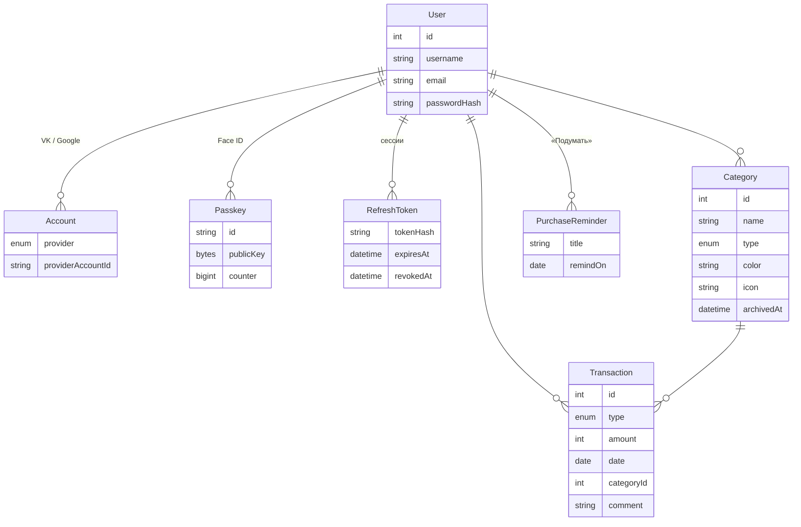
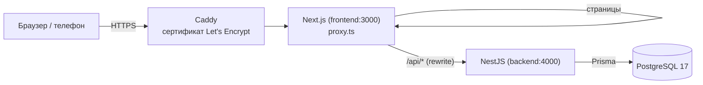
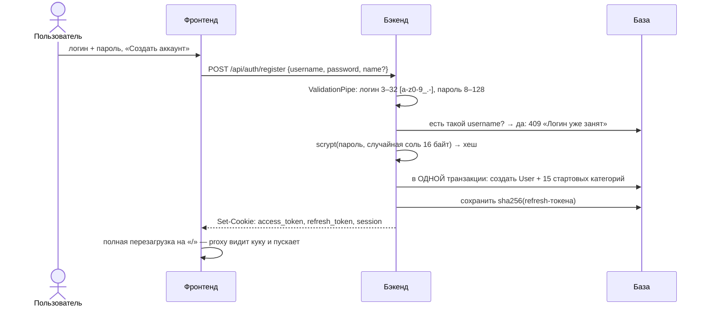
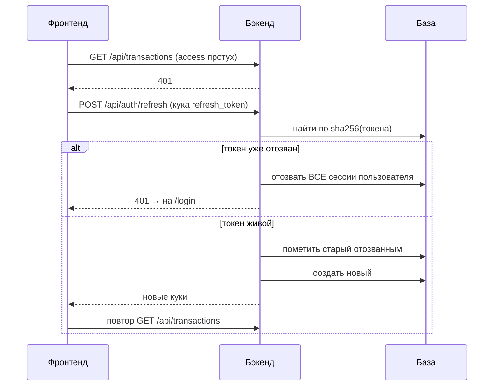
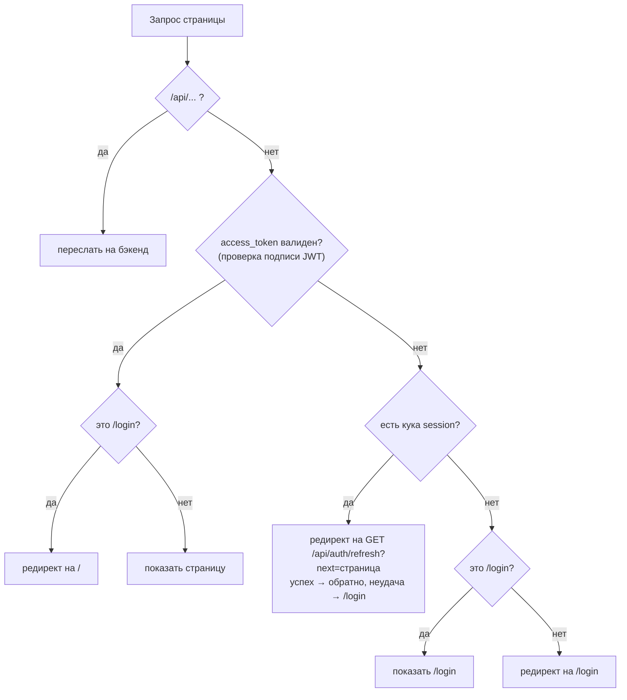
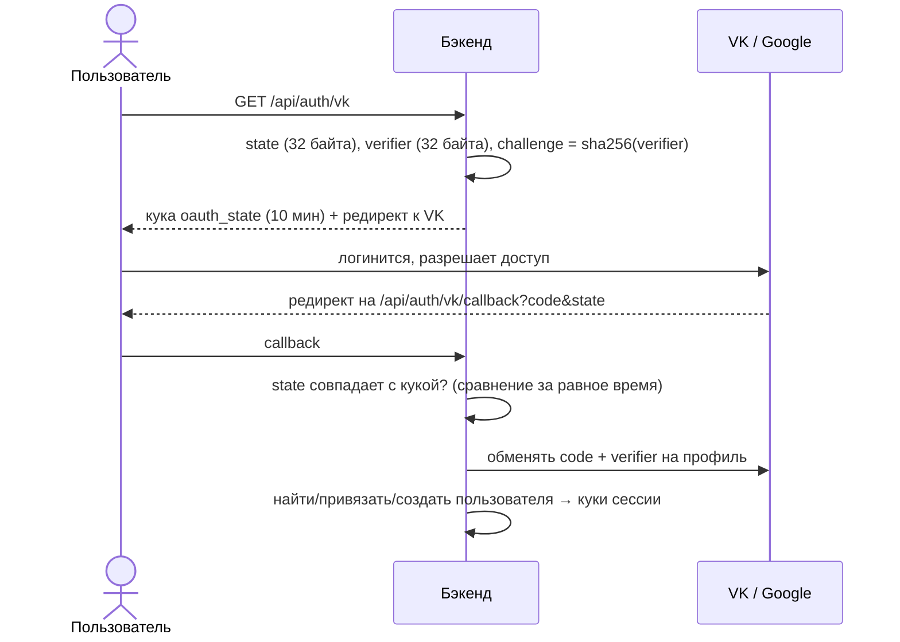
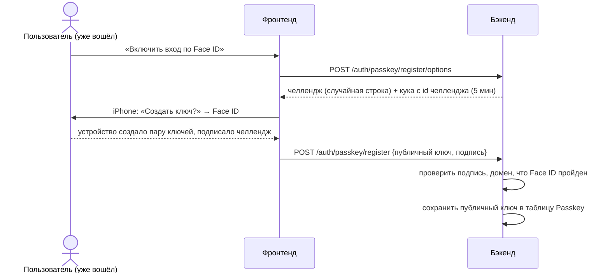

# MoneyWarden — объяснение проекта простым языком

Этот файл — шпаргалка к защите. Здесь по шагам разобрано, **как работает каждая часть проекта и почему она сделана именно так**. В конце — таблица всех чисел (сроки жизни токенов, лимиты) и список вопросов, которые могут задать, с короткими ответами.

Технический README (как запустить, переменные окружения, список API) — в [`README.md`](README.md). Схемы архитектуры и набросок дизайна — в [`docs/architecture/architecture.excalidraw`](docs/architecture/architecture.excalidraw) (открыть на [excalidraw.com](https://excalidraw.com) → Open).

## Содержание

1. [Что это за приложение](#1-что-это-за-приложение)
2. [Из чего состоит проект](#2-из-чего-состоит-проект)
3. [Путь одного запроса](#3-путь-одного-запроса)
4. [Регистрация и вход по паролю](#4-регистрация-и-вход-по-паролю)
5. [Как сессия живёт 30 дней: access и refresh токены](#5-как-сессия-живёт-30-дней-access-и-refresh-токены)
6. [Кто пускает на страницы: proxy фронтенда](#6-кто-пускает-на-страницы-proxy-фронтенда)
7. [Вход через VK и Google (OAuth)](#7-вход-через-vk-и-google-oauth)
8. [Вход по Face ID (passkeys)](#8-вход-по-face-id-passkeys)
9. [Деньги хранятся в копейках](#9-деньги-хранятся-в-копейках)
10. [Четыре типа операций](#10-четыре-типа-операций)
11. [Накопления и «корректировка накоплений»](#11-накопления-и-корректировка-накоплений)
12. [Категории](#12-категории)
13. [Операции: список, фильтры, страницы](#13-операции-список-фильтры-страницы)
14. [Статистика: что и как считается](#14-статистика-что-и-как-считается)
15. [«Подумать» — отложенные покупки](#15-подумать--отложенные-покупки)
16. [Даты и часовые пояса](#16-даты-и-часовые-пояса)
17. [Безопасность: кто что может](#17-безопасность-кто-что-может)
18. [Фронтенд: FSD и правила кода](#18-фронтенд-fsd-и-правила-кода)
19. [Как фронт получает данные (React Query)](#19-как-фронт-получает-данные-react-query)
20. [Интерфейс: мелочи, о которых могут спросить](#20-интерфейс-мелочи-о-которых-могут-спросить)
21. [PWA — «приложение» на телефоне](#21-pwa--приложение-на-телефоне)
22. [Docker и деплой на сервер](#22-docker-и-деплой-на-сервер)
23. [Тесты](#23-тесты)
24. [Swagger — документация API](#24-swagger--документация-api)
25. [Все числа проекта](#25-все-числа-проекта)
26. [Вопросы, которые могут задать](#26-вопросы-которые-могут-задать)

---

## 1. Что это за приложение

MoneyWarden — личный учёт финансов. Записываешь **расходы и доходы** по категориям, видишь, **сколько потратил за месяц и на что**, откладываешь деньги в **накопления**, а импульсивные покупки откладываешь в раздел **«Подумать»** — приложение напомнит о них через пару недель.

Работает в браузере на компьютере и на телефоне. На телефоне его можно «установить» на домашний экран как приложение (PWA) и входить по Face ID.

Живая версия: https://94-159-103-125.sslip.io

---

## 2. Из чего состоит проект

Монорепозиторий — две программы в одном git-репозитории:

| Папка | Что это | Технологии |
| ----- | ------- | ---------- |
| `frontend/` | Сайт, который видит пользователь | Next.js 16 (App Router), React, TypeScript, Tailwind CSS 4, shadcn/ui, TanStack Query, Recharts |
| `backend/` | Сервер с API и логикой | NestJS 12, TypeScript, Prisma 7 (ORM), class-validator |
| — | База данных | PostgreSQL 17 |
| `deploy/` | Настройки сервера | Docker Compose, Caddy (HTTPS) |
| `docs/` | Схемы | Excalidraw |

**Почему так:**
- **NestJS** — у бэкенда сразу есть структура: модули, контроллеры, сервисы, guard'ы, валидация DTO. Код по фичам: `auth`, `categories`, `transactions`, `stats`, `savings`, `reminders`.
- **Prisma** — схема базы описана в одном файле (`backend/prisma/schema.prisma`), из неё генерируются типы TypeScript и миграции. Запросы к базе типизированы — опечатка в названии поля не скомпилируется.
- **PostgreSQL** — надёжная реляционная база: внешние ключи, транзакции, CHECK-ограничения, блокировки строк. Всё это используется.
- **Next.js** — роутинг по папкам, серверный `proxy` для проверки входа, оптимизированная сборка.
- **TanStack Query** — кэш запросов: данные не грузятся заново при каждом переходе, после изменения обновляются сами.

### Таблицы в базе



У каждой записи есть `userId`, и при удалении пользователя удаляется всё его (`onDelete: Cascade`). Исключение — связь операции с категорией: там `Restrict`, категорию с операциями физически удалить нельзя (см. [раздел 12](#12-категории)).

---

## 3. Путь одного запроса

На сервере снаружи открыт только **Caddy** (порты 80 и 443). Бэкенд и база наружу не смотрят.



1. Браузер обращается к `https://…sslip.io/history` или к `https://…sslip.io/api/transactions`.
2. Caddy снимает HTTPS и передаёт запрос во фронтенд.
3. `frontend/proxy.ts` смотрит на путь:
   - `/api/…` → пересылает на бэкенд (rewrite). Браузер думает, что API на том же домене, поэтому куки авторизации — «свои» (first-party), никаких проблем с CORS и сторонними куками.
   - страница → проверяет, вошёл ли пользователь (см. [раздел 6](#6-кто-пускает-на-страницы-proxy-фронтенда)).
4. В NestJS запрос проходит: глобальный префикс `/api` → `cookieParser` → `JwtAuthGuard` (если эндпоинт закрыт) → `ValidationPipe` (проверка тела и параметров по DTO) → контроллер → сервис → Prisma → база.

---

## 4. Регистрация и вход по паролю



**Что важно рассказать:**

- **Логин приводится к нижнему регистру и обрезаются пробелы** (`Ivan ` → `ivan`) — нельзя зарегистрировать `Ivan` и `ivan` как разных людей.
- **Пароль не хранится.** Хранится хеш в формате `scrypt$<соль>$<хеш>`.
  - **scrypt** — специальная «медленная» функция для паролей (встроена в Node.js, `node:crypto`). Медленная специально: перебор миллионов паролей становится очень дорогим. Обычный sha256 для паролей не годится — он слишком быстрый.
  - **Соль** — 16 случайных байт, своя у каждого пользователя. Из-за неё у двух людей с паролем `12345678` хеши разные, и заранее посчитанные таблицы хешей бесполезны.
  - Длина хеша — 64 байта.
- **Проверка пароля при входе** — `timingSafeEqual`: сравнение за одинаковое время, чтобы по скорости ответа нельзя было угадывать хеш по байтам.
- **Ошибка входа одна на оба случая** — «Неверный логин или пароль». Так нельзя узнать, существует ли логин.
- **Стартовые категории создаются в той же транзакции**, что и пользователь: либо всё создалось, либо ничего. Не бывает пользователя без категорий.
- После успеха бэкенд ставит **три куки** (подробно — в следующем разделе), а фронт делает **полную перезагрузку** страницы, чтобы proxy перечитал куки и сбросился кэш.

---

## 5. Как сессия живёт 30 дней: access и refresh токены

Есть два токена, у каждого своя задача:

| | access_token | refresh_token | session |
| - | - | - | - |
| Что это | JWT (подписанная строка с `userId`) | случайные 32 байта | просто `1` |
| Живёт | **15 минут** | **30 дней** | 30 дней |
| Зачем | доказывает «я — пользователь 9» в каждом запросе | получить новую пару токенов | подсказка фронту «есть смысл обновиться» |
| Где хранится на сервере | нигде — проверяется подписью | в БД **только sha256-хеш** | нигде |
| Кука | httpOnly, path `/` | httpOnly, path **`/api/auth`** | не httpOnly, path `/` |

**Почему два токена, а не один долгий?**
- access проверяется **без запроса в базу** (просто проверка подписи) — быстро. Но его нельзя «отозвать», поэтому он короткий: 15 минут.
- refresh лежит в базе — его **можно отозвать** (выход, подозрение на кражу). Он ходит только на `/api/auth/*` (path куки), поэтому в обычных запросах не светится.

**httpOnly** — JavaScript страницы не может прочитать куку. Даже если на страницу внедрят вредный скрипт (XSS), токен он не украдёт.
**sameSite=lax** — кука не уходит с запросами, которые инициирует чужой сайт (защита от CSRF).
**secure** — кука только по HTTPS; включается, когда `FRONTEND_URL` начинается с `https://` (на сервере — да, локально на `http://localhost` — нет, иначе браузер не сохранил бы куки).

### Обновление (refresh) с ротацией



- **Ротация**: каждый refresh-токен одноразовый — при обновлении старый отзывается, выдаётся новый.
- **Обнаружение кражи**: если кто-то пришёл с **уже отозванным** токеном — значит, токен был скопирован, и им пользуются двое. Тогда гасим **все** сессии пользователя.
- **Гонка двух вкладок**: обновление делается через `updateMany(where: revokedAt = null)` — если две вкладки одновременно пришли с одним токеном, только одна его «погасит», вторая получит 401.
- На фронте **параллельные 401 ждут один и тот же refresh** (`shared/api/http.ts`): если 5 запросов одновременно получили 401, refresh пойдёт один раз.
- Для эндпоинтов входа (`/auth/login`, `/auth/register`, `/auth/passkey/login`…) refresh не пробуется: там 401 значит «неверные данные», а не «протухла сессия».

**Выход** (`POST /api/auth/logout`) — refresh-токен отзывается в базе, все три куки стираются.

---

## 6. Кто пускает на страницы: proxy фронтенда

`frontend/proxy.ts` (в Next.js 16 так называется бывший `middleware`) выполняется **до** отрисовки любой страницы:



- Proxy знает тот же секрет `JWT_ACCESS_SECRET`, что и бэкенд, и **проверяет подпись токена сам**, без запроса в базу.
- Если access протух, но кука `session` есть — пользователь, скорее всего, был залогинен. Его отправляют на `GET /api/auth/refresh` (именно туда, потому что refresh-кука видна только на `/api/auth`). Бэкенд обновит токены и вернёт обратно на ту же страницу.
- **Защита от open redirect**: параметр `next` принимается только как путь внутри сайта (`/history`), а `//evil.com` или `/\evil.com` отбрасываются.
- Кука `session` — **не пропуск**: подделать её можно, но proxy всё равно пускает только с валидным access, а refresh с поддельной кукой не пройдёт.

---

## 7. Вход через VK и Google (OAuth)

Используется **Authorization Code + PKCE** — стандартный безопасный способ.



- **state** — защита от подмены: callback принимается, только если `state` совпадает с тем, что мы сами положили в куку.
- **PKCE** — даже если `code` перехватят, без `verifier` (он есть только у нашего сервера) его не обменять.
- Кого пускаем после callback:
  1. этот VK/Google-аккаунт уже привязан → входим в того же пользователя;
  2. есть пользователь с тем же **подтверждённым** email → привязываем к нему;
  3. иначе создаём нового (email может быть `null` — VK отдаёт его не всегда).
- На сервере OAuth пока не настроен (нужны ключи приложений в VK/Google). Код работает, если задать `VK_CLIENT_ID` / `GOOGLE_CLIENT_ID`.

---

## 8. Вход по Face ID (passkeys)

**Passkey** — стандарт WebAuthn: вместо пароля у пользователя пара ключей. **Закрытый ключ** хранится в телефоне (на iPhone — в Связке ключей iCloud) и никогда его не покидает. **Публичный ключ** хранится у нас. Face ID / Touch ID проверяет **сам телефон** — до сервера лицо или отпечаток не доходят.

### Включение (в Настройках)



### Вход

1. `POST /auth/passkey/login/options` → сервер выдаёт новый челлендж.
2. Телефон сам предлагает подходящий ключ (логин вводить не нужно), спрашивает Face ID и **подписывает челлендж закрытым ключом**.
3. `POST /auth/passkey/login` → сервер находит ключ по id, **проверяет подпись публичным ключом** → выдаёт обычные куки сессии (как при входе по паролю).

**Почему это безопасно:**
- **Нечего украсть с сервера**: публичный ключ бесполезен для входа.
- **Фишинг не работает**: ключ привязан к домену (`rpID`). Поддельный сайт на другом домене ключ не получит.
- **Повтор не работает**: челлендж одноразовый и живёт 5 минут. Он хранится в памяти бэкенда, в куке — только его id. Использованный челлендж удаляется, перехваченный ответ второй раз не пройдёт.
- **Обязателен Face ID** (`userVerification: required`): без подтверждения лицом/пальцем вход отклоняется.

Библиотека — **SimpleWebAuthn** (`@simplewebauthn/server` и `/browser`): она разбирает бинарные форматы WebAuthn (CBOR, COSE) и проверяет подписи.

Нюанс: ключ привязан к домену. Если переехать на другой домен, Face ID нужно включить заново.

---

## 9. Деньги хранятся в копейках

Все суммы — **целые числа в копейках**: `1 250,50 ₽` хранится как `125050`.

**Почему не дробные числа?** В компьютере `0.1 + 0.2 = 0.30000000000000004`. Для денег такие ошибки недопустимы — копейки «теряются» при сложении. Целые числа складываются точно.

- Максимум одной операции — `1 000 000 000` копеек = **10 млн ₽** (`MAX_AMOUNT`).
- Минимум — 1 копейка (`amount > 0`).
- Фронт переводит рубли ↔ копейки при вводе и показе (`formatMoney`).

---

## 10. Четыре типа операций

Поле `Transaction.type`:

| Тип | Что значит | Категория | Сумма |
| --- | ---------- | --------- | ----- |
| `INCOME` | доход (зарплата, подработка…) | **обязательна** | > 0 |
| `EXPENSE` | расход (продукты, кафе…) | **обязательна** | > 0 |
| `SAVING` | «отложил в копилку» из текущих денег | **нет** | > 0 |
| `SAVING_ADJUSTMENT` | корректировка баланса копилки | **нет** | ≠ 0 (может быть минус) |

Эти правила проверяются **дважды**:
1. в DTO и сервисе бэкенда (понятные сообщения об ошибках);
2. **CHECK-ограничениями прямо в PostgreSQL** (миграция `*_savings`) — даже если в коде будет баг, база не даст сохранить «расход без категории» или «отложено −500 ₽».

Тип дохода/расхода **определяется категорией**: нельзя записать расход в категорию «Зарплата». При смене категории у операции может поменяться и тип (расход ↔ доход).

---

## 11. Накопления и «корректировка накоплений»

Это самый частый вопрос, поэтому подробно.

**«Накоплено всего» нигде не хранится — оно считается**: сумма всех `SAVING` + все `SAVING_ADJUSTMENT` пользователя. Поэтому если удалить операцию — итог пересчитается сам, рассинхрона быть не может.

### Зачем нужна корректировка?

Пример: пользователь начинает пользоваться приложением, а у него **уже** есть 300 000 ₽ на вкладе. Записывать их как «отложено в октябре» неправильно — он их откладывал годами, и статистика октября исказится.

Поэтому есть кнопка **«Изменить баланс»**: пользователь говорит «у меня сейчас 300 000 ₽», а сервер сам считает разницу:

```
было накоплено:         0 ₽
пользователь говорит: 300 000 ₽
корректировка:       +300 000 ₽   ← создаётся SAVING_ADJUSTMENT
```

Через месяц банк начислил проценты, или пользователь снял 20 000 ₽ — снова «Изменить баланс»:

```
было:    305 000 ₽ (300 000 + отложил 5 000)
стало:   285 000 ₽
корректировка: −20 000 ₽
```

**Главное правило:** корректировка **не влияет на статистику месяца** (доходы/расходы/«отложено в этом месяце»). Это не движение денег в этом месяце, а поправка баланса копилки. Поэтому её же не учитывает и список «месяцев с операциями».

- Если разница 0 — корректировка не создаётся.
- Корректировку **нельзя редактировать** (PATCH запрещён) — иначе это был бы обход правила «создаётся только через `PUT /savings/balance`». Можно удалить или задать баланс заново.
- **Защита от гонки**: если два запроса «Изменить баланс» придут одновременно, оба прочитают одинаковый итог и создадут две корректировки. Поэтому в транзакции сначала блокируется строка пользователя: `SELECT … FROM "User" WHERE id = … FOR UPDATE` — второй запрос ждёт, пока первый закончит.
- Одна корректировка ограничена размером колонки `INT4` (≈ 21,4 млн ₽); если разница больше — понятная ошибка.

### Отложено и свободный остаток

На главной во второй строке карточек:
- **Отложено** — сколько `SAVING` в этом месяце;
- **Свободный остаток** = доходы − расходы − отложено. То есть сколько денег реально осталось «на руках».
- **Баланс** = доходы − расходы (без учёта накоплений).

---

## 12. Категории

- При регистрации создаются **15 стартовых категорий**: 10 расходов (Продукты, Кафе и рестораны, Транспорт, Жильё и ЖКХ, Связь и интернет, Здоровье, Одежда, Развлечения, Подарки, Другое) и 5 доходов (Зарплата, Подработка, Подарки, Кэшбэк и проценты, Другое).
- У категории: название (1–50 символов), тип (доход/расход), цвет `#RRGGBB`, иконка (имя иконки из lucide).
- **Тип категории менять нельзя** — у неё уже могут быть операции этого типа.
- **Названия уникальны без учёта регистра** среди активных категорий одного типа: нельзя иметь «Кафе» и «кафе». Но «Подарки» может быть и в доходах, и в расходах.
- **«Другое» всегда в конце списка** своего типа — новые категории встают перед ней.

### Удаление = архив, если есть операции

- Если у категории **нет операций** — она удаляется по-настоящему.
- Если **есть** — она **архивируется** (`archivedAt`): пропадает из выбора при добавлении операции, но старые операции и статистика остаются целыми. Это «мягкое удаление».
- В архивную категорию нельзя записать новую операцию. Из архива можно восстановить.
- На уровне базы связь операции с категорией — `onDelete: Restrict`: даже случайно удалить категорию с операциями база не даст.

---

## 13. Операции: список, фильтры, страницы

`GET /api/transactions` — список с фильтрами:
- период: `month=YYYY-MM` **или** `from` + `to` (например, один день — так работает клик по столбику графика);
- тип, несколько категорий (`categoryIds=1,2,3`), сумма от/до, поиск по комментарию (без учёта регистра, до 100 символов).

**Пагинация** — постранично: `page` (с 1) и `limit` (1–100, по умолчанию 50; фронт берёт по 30). Кнопка «Показать ещё» грузит следующую страницу.

Вместе со страницей возвращаются **итоги по всему фильтру** (не только по странице): сколько операций, сумма доходов, расходов, отложенного — это строка над списком в «Истории».

Сортировка: по дате (новые сверху), внутри дня — по времени создания.

Комментарий — до 500 символов.

---

## 14. Статистика: что и как считается

Все расчёты — **на сервере, запросами к базе** (`groupBy`, `SUM`), а не загрузкой всех операций на фронт.

| Эндпоинт | Что возвращает |
| -------- | -------------- |
| `GET /stats/summary` | доходы, расходы, баланс, отложено, свободный остаток за период + **сравнение с прошлым периодом в %** |
| `GET /stats/categories` | разбивка по категориям: сумма, число операций, доля |
| `GET /stats/monthly` | доходы и расходы по месяцам (по умолчанию 12, максимум 36) |
| `GET /stats/daily` | суммы по дням месяца, среднее в день, самый крупный день |
| `GET /stats/months` | месяцы, в которых есть операции (для выбора месяца) |

**Детали, о которых могут спросить:**
- **Процент изменения** = (сейчас − раньше) / раньше × 100, один знак после запятой. Если в прошлом месяце было 0 — процент `null` (делить на ноль нельзя, на фронте «нет данных для сравнения»).
- **«Прошлый период»**: для целого месяца — предыдущий календарный месяц; для произвольного периода — такой же длины сразу перед ним.
- **Доля категории** округляется до 4 знаков (0.3512 = 35,12%).
- **Среднее в день** для текущего месяца делится на **прошедшие** дни, а не на 31 — иначе 20 числа среднее было бы занижено.
- **Пустые дни/месяцы** дозаполняются нулями (`fillDays`, `fillMonths`), чтобы на графике не было «дыр».
- На главной показываются **4 крупнейшие категории**, остальные сворачиваются в «Остальное». На странице статистики в бублике — до 7 + «Остальное», если категорий больше 8.
- **Клик по категории / столбику** открывает «Историю» с нужным фильтром.
- Максимальная длина произвольного периода — 5 лет (1830 дней) — чтобы нельзя было одним запросом нагрузить базу.

---

## 15. «Подумать» — отложенные покупки

Идея из финансовой грамотности: **импульсивную покупку не делать сразу**, а вернуться к ней через время на «холодную голову».

- Пользователь пишет, что хочет купить («Спиннинг»), и через сколько дней напомнить — **от 3 до 30 дней** (по умолчанию 14).
- Когда день наступает, на **главной** появляется карточка: «Помнишь, хотелось купить: Спиннинг? Прошло 14 дней — всё ещё нужно?» и кнопка «Закрыть».
- Какие напоминания уже «наступили», решает **фронт по своей дате** — у пользователя свой часовой пояс.
- Сервер проверяет диапазон 3–30 дней **с запасом в 1 день в обе стороны**: сервер считает «сегодня» в UTC, а у пользователя может быть уже завтра (или ещё вчера).

---

## 16. Даты и часовые пояса

- Дата операции хранится как **`DATE` без времени** (`2026-10-17`), не как момент времени.
- Почему: если хранить «17 октября 00:30 по Москве» как UTC-время, это будет 16 октября 21:30 — и операция «переедет» в другой день и даже месяц. С `DATE` день всегда тот, который выбрал пользователь.
- Вся арифметика дат на бэкенде — в UTC (`common/period.ts`), даты в API — строки `YYYY-MM-DD`.
- `parseDate` отвергает несуществующие даты вроде `2026-02-30`.

---

## 17. Безопасность: кто что может

- **Чужие данные недоступны.** Каждый запрос к базе содержит `userId` текущего пользователя. Получение/изменение/удаление по id делается через `findFirst({ where: { id, userId } })` — если запись чужая, ответ **404 «не найдена»** (не 403 — чтобы даже не подтверждать, что такая запись существует). В e2e-тестах это проверено на напоминаниях и ключах Face ID: чужой пользователь получает 404.
- **`userId` берётся только из токена**, а не из тела запроса — подменить его нельзя.
- **Валидация входа** — глобальный `ValidationPipe`:
  - `whitelist` — лишние поля из запроса выбрасываются;
  - `forbidNonWhitelisted` — если прислали неизвестное поле, ошибка 400 (например, попытка передать `userId`);
  - `transform` — строки из URL превращаются в числа/булевы.
- **SQL-инъекции** невозможны: Prisma передаёт параметры отдельно от текста запроса; в «сырых» запросах используется шаблон `$queryRaw\`…${param}\``, который тоже экранирует параметры.
- **Пароли** — scrypt с солью; **refresh-токены** — в базе только sha256-хеш (утечка базы не даст войти).
- **Куки** — httpOnly, sameSite=lax, secure по HTTPS.
- **Open redirect** — закрыт (раздел 6). **OAuth** — state + PKCE. **Face ID** — одноразовые челленджи, привязка к домену.
- **Инварианты в базе** — CHECK-ограничения и внешние ключи (раздел 10).
- **Наружу открыт только Caddy** с HTTPS; бэкенд и Postgres в Docker-сети недоступны из интернета.

---

## 18. Фронтенд: FSD и правила кода

Код фронта разложен по **Feature-Sliced Design** — слои сверху вниз, верхний может импортировать только нижние:

```
app       — провайдеры, глобальные стили, роутинг Next.js
pages     — страницы целиком (Главная, История, Статистика, Подумать, Настройки, Вход)
widgets   — крупные блоки (дашборд, сайдбар + нижние вкладки, панель накоплений)
features  — действия пользователя (добавить операцию, выбрать месяц, вход, Face ID, тема)
entities  — сущности (пользователь, категория, операция, статистика, напоминание)
shared    — общее без бизнес-логики (http-клиент, UI-кит, форматирование, guards)
```

**Правила, которых придерживается код:**
- Внутри слайса: `ui/Component.tsx` + `index.ts`, вложенные компоненты в `components/` (по одному на файл), константы в `model/*.const.ts`.
- Импорт слайса — **только через его `index.ts`** (публичный API), без `export *`.
- API-сервис и его интерфейс — в разных файлах: `api/<name>.service.ts` и `api/<name>.service.interface.ts`.
- **Ответы сервера проверяются type guard'ами** (`shared/lib/guards`): `shape`, `arrayOf`, `nullable`… В компонент попадают только данные правильной формы. Если сервер вернул что-то не то — понятная ошибка «Неожиданный ответ сервера», а не падение где-то в глубине.
- **Запрещены `as`, `!` и `any`** — то есть «поверь мне, тут такой тип». Вместо этого — проверка guard'ом.

Пример guard'а:

```ts
export const isPasskey: Guard<Passkey> = shape<Passkey>({
  id: isString,
  name: isString,
  createdAt: isString,
  lastUsedAt: nullable(isString),
});
```

---

## 19. Как фронт получает данные (React Query)

- Все запросы — через `request()` из `shared/api/http.ts`: добавляет `/api`, сериализует тело, на 401 делает refresh и повторяет, проверяет ответ guard'ом.
- **TanStack Query** кэширует ответы: данные считаются свежими **30 секунд** (`staleTime`), при ошибке — **1 повтор** (`retry`), без перезапроса при возврате на вкладку.
- Профиль (`/auth/me`) не устаревает вообще (`staleTime: Infinity`) — он меняется редко.
- После добавления/изменения/удаления операции сбрасываются кэши **операций, статистики и накоплений** — всё, что от них зависит, обновится само.
- Ключи кэша общие (`QUERY_KEYS` в `shared/api`), чтобы одна сущность могла сбросить кэш другой без импортов между слайсами.

---

## 20. Интерфейс: мелочи, о которых могут спросить

- **Выбранный месяц живёт в адресе** — `?m=2026-09`. Переживает переходы между страницами и перезагрузку; для текущего месяца параметра нет. В выборе — только месяцы, где есть операции (+ текущий).
- **Своя цифровая клавиатура** при вводе суммы (а не системная) — крупные кнопки, запятая, максимум **8 цифр** целой части (= лимит 10 млн ₽).
- **Последняя категория запоминается** (в `localStorage`) — при следующей записи расхода она уже выбрана.
- **Быстрое добавление**: на телефоне — круглые «−» (расход) и «+» (доход) справа внизу главной; на компьютере — кнопки «Расход»/«Доход» в сайдбаре на любой странице.
- **Телефон**: нижние вкладки (Главная, История, Статистика, Подумать, Настройки), отступы под «чёлку» и полоску iPhone (`safe-area-inset`).
- **iOS не зумит поля ввода**: у полей шрифт 16px на телефоне — Safari приближает экран, если шрифт меньше 16px.
- **Тёмная тема** — переключатель в Настройках; цвета заданы CSS-переменными для светлой и тёмной темы.
- **Брейкпоинт** телефон/компьютер — 768px (`md:` в Tailwind).

---

## 21. PWA — «приложение» на телефоне

- `app/manifest.ts` — имя, иконки 192 и 512 px, цвет темы, `display: standalone` (открывается без адресной строки браузера).
- На iPhone: Safari → «Поделиться» → «На экран „Домой“». Иконка на рабочем столе, запуск на весь экран.
- Учтены вырезы экрана (`viewportFit: cover` + `safe-area`), цвет статус-бара для светлой и тёмной темы.

---

## 22. Docker и деплой на сервер

**Локально**: `docker compose up -d --build` поднимает 3 контейнера — `db` (Postgres), `backend`, `frontend`.

**На сервере** (`deploy/docker-compose.yml`) — 4 контейнера, добавляется **Caddy**:
- Caddy сам получает и продлевает **HTTPS-сертификат Let's Encrypt** для домена.
- Домен `94-159-103-125.sslip.io` — сервис sslip.io превращает любой IP в доменное имя бесплатно (сертификат выдаётся только на домен, не на IP).
- Образы собираются у меня локально под `linux/amd64` и копируются на сервер (`docker save | ssh docker load`) — у сервера всего 1 CPU и 1 ГБ памяти, сборка Next.js на нём была бы очень долгой.
- **Миграции базы применяются автоматически** при старте бэкенда: `prisma migrate deploy && node dist/main.js`.
- Секреты (пароль базы, `JWT_ACCESS_SECRET`) лежат только на сервере в `.env` с правами `600`; в git — только `.env.example` с пустыми значениями.
- Многоэтапные Dockerfile (`deps` → `build` → `runner`) на `node:24-alpine` — в итоговом образе нет исходников и dev-зависимостей.

---

## 23. Тесты

Бэкенд, `vitest`:
- **Unit-тесты (18)** — чистые функции: расчёт периодов и дат, дозаполнение графиков нулями, итоги месяца, расчёт корректировки накоплений.
- **e2e-тесты (32)** — поднимают всё приложение с настоящей базой и ходят по HTTP:
  - авторизация и refresh (протухшая сессия, поддельный токен);
  - статистика, накопления, напоминания, изоляция данных пользователей;
  - **Face ID**: в тесте сделан **программный аутентификатор** (`test/virtual-authenticator.ts`) — он делает то же, что iPhone: создаёт ключ P-256 и подписывает челленджи. Проверяются регистрация, вход, повтор старого ответа, вход без Face ID, чужой ключ, удаление.

Запуск: `cd backend && npm test && npm run test:e2e`.

Фронтенд проверяется линтером (ESLint) и компилятором TypeScript; сборка (`next build`) тоже ловит ошибки.

---

## 24. Swagger — документация API

`/api/docs` — интерактивная документация всех эндпоинтов (сгенерирована из кода через `@nestjs/swagger`). Можно прямо там войти и отправлять запросы. Группы и описания — на русском.

Локально: http://localhost:4000/api/docs. На сервере: https://94-159-103-125.sslip.io/api/docs.

---

## 25. Все числа проекта

### Авторизация

| Что | Значение | Где в коде |
| --- | -------- | ---------- |
| Жизнь access-токена (JWT) | **15 минут** | `ACCESS_TOKEN_TTL_SEC` — `backend/src/auth/tokens.service.ts` |
| Жизнь refresh-токена | **30 дней** | `REFRESH_TOKEN_TTL_SEC` — там же |
| Жизнь куки `session` | 30 дней | `auth.cookies.ts` |
| Длина refresh-токена | 32 случайных байта | `tokens.service.ts` |
| Хранение refresh в БД | sha256-хеш | `tokens.service.ts` |
| Логин | 3–32 символа, `a-z 0-9 _ . -`, без учёта регистра | `auth/dto/credentials.ts` |
| Пароль | 8–128 символов | там же |
| Имя при регистрации | до 100 символов | `auth/dto/register.dto.ts` |
| Соль scrypt | 16 байт | `auth/password.ts` |
| Длина хеша scrypt | 64 байта | `KEY_LENGTH` — там же |
| OAuth: жизнь куки `oauth_state` | **10 минут** | `STATE_TTL_MS` — `oauth/oauth.controller.ts` |
| OAuth: state и PKCE verifier | по 32 случайных байта | там же |
| Face ID: жизнь челленджа | **5 минут**, одноразовый | `CHALLENGE_TTL_MS` — `passkey/challenge-store.ts` |
| Face ID: id челленджа в куке | 16 случайных байт | там же |
| Face ID: название ключа | 1–60 символов | `passkey/passkey.dto.ts` |

### Деньги и операции

| Что | Значение | Где в коде |
| --- | -------- | ---------- |
| Единица хранения сумм | копейки (целые) | вся схема |
| Максимум одной операции | 1 000 000 000 коп. = **10 млн ₽** | `MAX_AMOUNT` — `transactions/dto/transaction.dto.ts` |
| Минимум операции | 1 копейка | там же |
| Ввод суммы на фронте | до **8 цифр** целой части | `MAX_AMOUNT_INT_DIGITS` — `features/transaction-editor` |
| Комментарий | до **500** символов | `transaction.dto.ts` |
| Поиск по комментарию | до **100** символов | там же |
| Страница списка | `limit` 1–**100**, по умолчанию **50** | там же |
| Страница на фронте | **30** операций | `entities/transaction/api/queries.ts` |
| Максимум одной корректировки накоплений | 2 147 483 647 коп. (≈ 21,4 млн ₽, INT4) | `INT4_MAX` — `savings/balance.ts` |
| Максимальный период запроса | 366 × 5 = **1830 дней** (≈5 лет) | `MAX_PERIOD_DAYS` — `common/period.ts` |

### Категории

| Что | Значение |
| --- | -------- |
| Стартовых категорий | **15** (10 расходов + 5 доходов) |
| Название | 1–**50** символов, уникально без учёта регистра в своём типе |
| Иконка (имя) | до 50 символов |
| Цвет | `#RRGGBB` |

### Статистика

| Что | Значение |
| --- | -------- |
| Месяцев в графике «за год» | по умолчанию **12**, от 1 до **36** |
| Категорий на главной | топ-**4** + «Остальное» |
| Категорий в бублике статистики | топ-**7** + «Остальное», если их больше 8 |
| Округление процента изменения | 1 знак после запятой (`null`, если прошлый период = 0) |
| Округление доли категории | 4 знака (0.3512) |

### «Подумать»

| Что | Значение |
| --- | -------- |
| Напомнить через | от **3** до **30** дней |
| По умолчанию | **14** дней |
| Запас на часовой пояс | ±1 день |
| Название покупки | 1–**100** символов |

### Фронтенд

| Что | Значение |
| --- | -------- |
| Данные в кэше считаются свежими | **30 секунд** (`staleTime`) |
| Повторов при ошибке запроса | **1** |
| Профиль пользователя в кэше | не устаревает (`Infinity`) |
| Граница телефон/компьютер | **768 px** (`md:`) |
| Ширина сайдбара | **248 px** |
| Шрифт полей ввода на телефоне | **16 px** (иначе iOS зумит) |
| Иконки PWA | **192** и **512** px |

### Инфраструктура

| Что | Значение |
| --- | -------- |
| Порт фронтенда | **3000** |
| Порт бэкенда | **4000** |
| Порт Postgres снаружи (локально) | **5433** (внутри контейнера 5432) |
| Порты Caddy на сервере | **80**, **443** |
| Версии | Node **24**, PostgreSQL **17**, Next.js **16**, NestJS **12**, Prisma **7** |
| Сервер | 1 CPU, 1 ГБ RAM, Ubuntu 24.04 |
| Проверка здоровья Postgres | каждые 5 с, до 10 попыток |
| Тесты | **18** unit + **32** e2e |

---

## 26. Вопросы, которые могут задать

**— Где хранится пароль?**
Нигде. Хранится хеш scrypt с солью. Проверка — повторным хешированием введённого пароля и сравнением за равное время.

**— Почему JWT живёт всего 15 минут? Пользователя же выкинет.**
Не выкинет: по refresh-токену (30 дней) фронт тихо получает новый access. Короткий access — потому что его нельзя отозвать, а refresh — можно.

**— Что будет, если украдут refresh-токен?**
Воспользуются им один раз — и токен ротируется. Когда настоящий пользователь придёт со старым (уже отозванным) токеном, сервер поймёт, что токен скопирован, и погасит все сессии. Плюс в базе только хеш — из базы токен не достать.

**— Почему токены в куках, а не в localStorage?**
httpOnly-куку не может прочитать JavaScript страницы — XSS не украдёт токен. localStorage доступен любому скрипту.

**— Как вы защищаетесь от CSRF?**
`sameSite=lax` на куках: браузер не отправит их с POST-запросом, который инициирован чужим сайтом. Плюс API на том же домене, что и фронт.

**— Может ли пользователь увидеть чужие операции, подставив id?**
Нет. Все запросы фильтруются по `userId` из токена; чужая запись — 404. Для напоминаний и ключей Face ID это проверено e2e-тестами.

**— Что такое корректировка накоплений?**
Способ сказать «у меня в копилке сейчас N рублей» без искажения статистики. Сервер сам считает разницу с текущим итогом и создаёт операцию `SAVING_ADJUSTMENT` на эту разницу. На доходы/расходы месяца она не влияет. ([раздел 11](#11-накопления-и-корректировка-накоплений))

**— Почему суммы в копейках?**
Дробные числа в компьютере складываются с погрешностью (`0.1 + 0.2 ≠ 0.3`). Целые — точно.

**— Что будет, если удалить категорию, в которой есть траты?**
Она уйдёт в архив: исчезнет из выбора, но история и статистика останутся. Пустая категория удаляется полностью.

**— Как работает Face ID? Вы храните лицо?**
Нет. Лицо проверяет сам iPhone. У нас хранится только публичный ключ; телефон после Face ID подписывает случайную строку от сервера закрытым ключом, а мы проверяем подпись. ([раздел 8](#8-вход-по-face-id-passkeys))

**— Почему дата операции без времени?**
Чтобы операция не «переезжала» в другой день из-за часовых поясов. ([раздел 16](#16-даты-и-часовые-пояса))

**— Зачем proxy на фронте, если бэкенд и так проверяет токен?**
Бэкенд защищает данные, а proxy — страницы: незалогиненного он сразу отправляет на `/login`, не отрисовывая приложение. И он же пересылает `/api` на бэкенд, чтобы всё было на одном домене.

**— Что такое FSD и зачем?**
Способ разложить фронт по слоям (app → pages → widgets → features → entities → shared), где верхние слои зависят только от нижних. Код легко найти, и изменения в одной фиче не ломают другие. ([раздел 18](#18-фронтенд-fsd-и-правила-кода))

**— Почему нет `as` и `any`?**
Это «отключение» проверки типов. Вместо них данные с сервера проверяются type guard'ами — если сервер вернёт не то, ошибка будет сразу и понятная.

**— Как приложение попадает на сервер?**
Собираю Docker-образы, копирую на сервер, `docker compose up -d`. Миграции базы применяются при старте бэкенда. HTTPS делает Caddy с сертификатом Let's Encrypt. ([раздел 22](#22-docker-и-деплой-на-сервер))

**— Что если два запроса одновременно изменят баланс накоплений?**
Строка пользователя блокируется (`SELECT … FOR UPDATE`), запросы выполняются по очереди — двойной корректировки не будет.

**— Откуда берутся проценты «↑ 12% к сентябрю»?**
`(этот месяц − прошлый) / прошлый × 100`, округление до 0,1. Если в прошлом месяце было 0 — процента нет (делить на ноль нельзя).

**— Почему среднее в день в текущем месяце такое?**
Делится на прошедшие дни месяца, а не на все 31 — иначе в середине месяца среднее было бы занижено вдвое.

**— Что такое «Подумать»?**
Защита от импульсивных покупок: записываешь желаемую вещь, через 3–30 дней (по умолчанию 14) приложение спросит «всё ещё нужно?».
